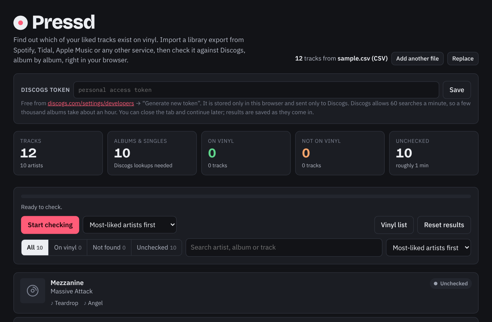
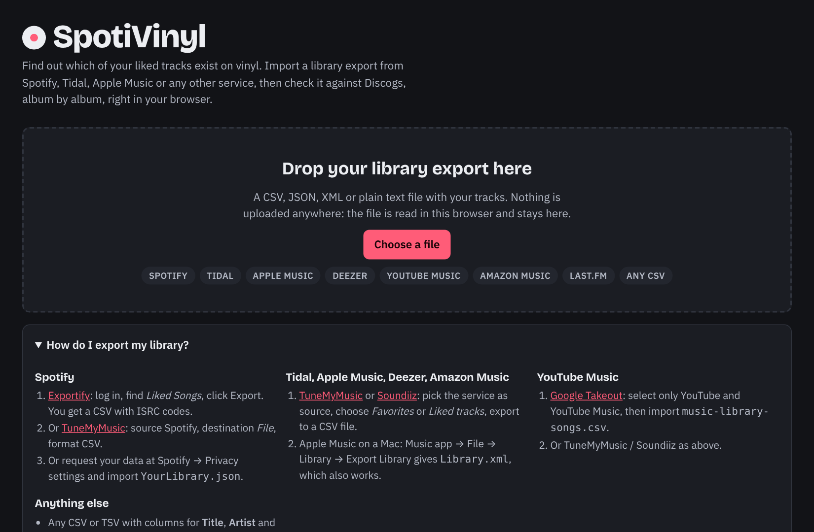

<div align="center">

# Pressd

### Which of your liked tracks exist on vinyl?

Import your library from Spotify, Tidal, Apple Music, Deezer, YouTube Music or any CSV.<br>
Pressd checks every album against Discogs and tells you what you could own on wax.

**[Open the app → spotivinyl.pages.dev](https://spotivinyl.pages.dev)**

<sub>The project was renamed from SpotiVinyl to Pressd. The site still lives at the old address for now; moving it to a proper domain is the top item on the list and will happen shortly.</sub>

[](LICENSE)
[](https://pages.cloudflare.com)
[](https://www.discogs.com/developers)



</div>

## What it does

1. **Drop in a library export.** The file is parsed in your browser and never uploaded.
2. **Log in with Discogs** (or paste a personal token).
3. **Press *Start checking*.** Each album or single is looked up on Discogs with a vinyl filter, about one per second. Every hit links to the Discogs release with year, country and format, and can be dismissed if it is the wrong record.
4. **Keep the list.** Filter by *On vinyl*, copy the list or download it as CSV, and come back any time: results are saved as they arrive.

A **shared cache** makes it faster for everyone. An album anyone has already resolved is not looked up again, so popular records resolve instantly and only your long tail hits Discogs.

## Supported exports

| Service | How to get the file |
|---|---|
| Spotify | [Exportify](https://exportify.net) (Liked Songs → Export), [TuneMyMusic](https://www.tunemymusic.com) or the privacy export `YourLibrary.json` |
| Tidal, Apple Music, Deezer, Amazon Music | [TuneMyMusic](https://www.tunemymusic.com) or [Soundiiz](https://soundiiz.com), export favourites to a CSV file |
| Apple Music / iTunes on a Mac | File → Library → Export Library (`Library.xml`) |
| YouTube Music | [Google Takeout](https://takeout.google.com) → `music-library-songs.csv`, or TuneMyMusic |
| Anything else | Any CSV/TSV with Title, Artist and Album columns, a JSON array of tracks, or a text file with one `Artist - Title` per line |

Column names are detected automatically. Several files can be combined with *Add another file*.

<div align="center"></div>

## Privacy

- Your library and your results live in your browser's local storage. Nothing about your listening history is stored on the server.
- Logging in with Discogs gives the server a token for your Discogs account, kept in a database only so it can sign your searches. It is never sent anywhere else. Log out to delete it.
- The shared cache stores one line per album: artist, album, whether a vinyl pressing exists and which Discogs release matched. It does not record who likes what.
- Searches go from your browser straight to Discogs. Discogs rate-limits by IP address, which is exactly why: everyone gets their own 60 requests a minute.

## How matching works

- Tracks are grouped into albums by artist and album name, after stripping suffixes such as `(feat. …)`, `- Single`, `- Remastered`.
- One Discogs search per album with `format=Vinyl`. If it comes back empty, a second search uses the first track title.
- A result counts only when the artist part of the Discogs title matches the library artist. Among matching results the exact album title wins. A match found through a track search, or without an exact title match, is labelled *please verify*.
- A *vinyl* verdict in the shared cache is never overwritten by a *none*; a *none* expires after 180 days so new pressings get picked up. Manual dismissals stay local.
- ISRC codes, when the export has them, feed the statistics panel (release years and registrant prefixes).

## Self-hosting

The page itself is static and runs from any web server or a local folder. In that mode users paste their own Discogs token and there is no shared cache.

The full experience (login and shared cache) uses Cloudflare Pages Functions and a D1 database. Everything fits in the free tiers.

1. **Pages project.** Create a Pages project from this repository: build command empty, output directory `/`. The `functions/` directory is picked up automatically.
2. **Discogs application.** At <https://www.discogs.com/settings/developers> click *Create an Application* and set the callback URL to `https://<your-domain>/auth/callback`. Copy the consumer key and secret.
3. **D1 database.** *Storage & Databases → D1 → Create*. Any name. Tables are created on first use.
4. **Bindings.** In the Pages project, *Settings → Bindings*: add the D1 binding with variable name `DB`. Under *Variables and Secrets* add `DISCOGS_CONSUMER_KEY` and `DISCOGS_CONSUMER_SECRET` as secrets.
5. Redeploy. `GET /api/me` should answer `{"username":null,"loginAvailable":true,"sharedCache":true}`.

Without the D1 binding the page falls back to token mode. Without the Discogs keys login is hidden and the shared cache is read-only.

## Project layout

| Path | Purpose |
|---|---|
| `index.html` | markup and styles |
| `app.js` | library state, check loop, list, export, statistics, hosted-mode client |
| `importers.js` | library parsers (also usable in Node for tests) |
| `functions/api/oauth.js` | signs each step of the Discogs OAuth handshake; the browser sends them |
| `functions/api/sign.js` | signs a Discogs search for the logged-in user |
| `functions/api/cache.js` | shared verdict cache (read: anyone, write: logged-in users) |
| `functions/api/me.js` | who is logged in, which features the deployment has |
| `functions/api/search.js` | server-side search proxy, last-resort fallback |
| `functions/auth/*` | server-side login fallback, OAuth callback, logout |
| `functions/lib/*` | OAuth signing, D1 access, sessions |

### Local development

```bash
npm i -D wrangler
npx wrangler pages dev . --d1 DB --binding DISCOGS_CONSUMER_KEY=… DISCOGS_CONSUMER_SECRET=…
```

`DISCOGS_API` and `DISCOGS_AUTHORIZE` can be overridden to point the functions at a stand-in server for tests. The importers run in Node:

```js
require('./importers.js');
Importers.importLibrary(require('fs').readFileSync('export.csv', 'utf8'), 'export.csv');
```

## Roadmap

- Add found albums to your Discogs wantlist in one click.
- Marketplace price range next to each match.
- Your results across devices (the login already identifies you).

## Credits

Data provided by [Discogs](https://www.discogs.com). Pressd is not affiliated with Discogs, Spotify or any other music service. Released under the [MIT License](LICENSE).
